# Lektion 5: Halloween & Herbst Matrix Engine & Animationen

Willkommen zu Lektion 5! In dieser Lektion wird die 16x16 NeoPixel LED-Matrix zum Leben erweckt. Wir steuern 32 verschiedene Halloween- und Herbst-Klassiker mit flüssigen 4-Frame-Animationen an. Ausserdem zeigt die Lektion, wie Grafiken über eine strukturierte JSON-Datei geladen und entweder automatisch abgespielt oder interaktiv mit dem Arcade Joystick gesteuert werden.

## Übersicht der Dateien

- **`images.json`**: Enthält die Farbpalette sowie alle 32 Motive mit jeweils 4 Animationsframes im ASCII-Art-Raster-Format (16x16).
- **`code.py`**: Automatische Wiedergabe-Engine. Das Skript lädt `images.json` und spielt thematisch passende Motiv-Gruppen in einer Endlosschleife auf der LED-Matrix ab.
- **`code.joystick.py`**: Interaktive Steuerung. Erlaubt das Wechseln zwischen Motiven und einzelnen Frames über den angeschlossenen Arcade Joystick.
- **`pixel.py`**: Beispielsammeldatei für Koordinaten- und Positionslogik von Pixel-Objekten.
- **`render_images.py`**: Hilfsskript zum automatischen Rendern aller 32 Motive in PNG-Einzelbilder (128 Frames) und animierte GIFs (32 Dateien).

## Hardware & Joystick-Steuerung

Falls du die interaktive Version (`code.joystick.py`) wählst, verwende die folgende Belegung für deinen Arcade Joystick am Seeed Studio XIAO RP2040:

| Joystick-Richtung | Anschluss (Pin) | GP-Nummer | Funktion |
| :--- | :---: | :---: | :--- |
| **Oben** | **D4** | GP06 | Vorheriges Motiv wählen |
| **Unten** | **D5** | GP07 | Nächstes Motiv wählen |
| **Links** | **D0** | GP26 | Vorherigen Animationsframe anzeigen |
| **Rechts** | **D1** | GP27 | Nächsten Animationsframe anzeigen |

> **Hinweis**: Vergiss nicht, `code.joystick.py` in `code.py` umzubennen und zusammen mit `images.json` auf das `CIRCUITPY`-Laufwerk deines Microcontrollers zu kopieren.

---

## Galerie der 32 Motive

Jedes Motiv besteht aus einer 16x16 Matrix und 4 Animationsframes. Hier ist die Übersicht aller verfügbaren Motive:

| ID | Motivname | Beschreibung der Animation | Vorschau (Animation) |
| :-: | :--- | :--- | :-: |
| **1** | **Jack-o'-Lantern** | Candle Flicker & Laugh |  |
| **2** | **Classic Ghost** | Floating & Waving Tail |  |
| **3** | **Skull** | Chattering Jaw & Glowing Eyes |  |
| **4** | **Vampire Bat** | Flapping Wings |  |
| **5** | **Black Cat** | Looking Around & Blinking |  |
| **6** | **Witch Hat** | Wagging Tip & Sparkling Buckle |  |
| **7** | **Candy Corn** | Magical Sparkles & Shine |  |
| **8** | **Frankenstein** | High Voltage Neck Bolts |  |
| **9** | **Bubbling Cauldron** | Rising & Popping Potion Bubbles |  |
| **10** | **Descending Spider** | Dropping Down on Web |  |
| **11** | **Bloodshot Eyeball** | Darting Pupil Left & Right |  |
| **12** | **RIP Tombstone** | Zombie Hand Emerging |  |
| **13** | **Vampire** | Baring Fangs & Dripping Blood |  |
| **14** | **Mummy** | Glowing Eyes & Shifting Eyes |  |
| **15** | **Witch's Broom** | Sweeping & Magic Trail |  |
| **16** | **Crescent Moon** | Passing Night Clouds |  |
| **17** | **Autumn Maple Leaf** | Color Shift & Morning Dew | 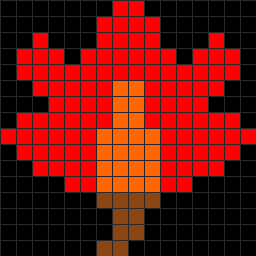 |
| **18** | **Haunted House** | Lightning Strike & Flickering Windows | 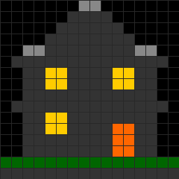 |
| **19** | **Wise Owl** | Head Tilt, Blink & Hoot | 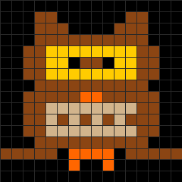 |
| **20** | **Toadstool Mushroom** | Glowing Spores | 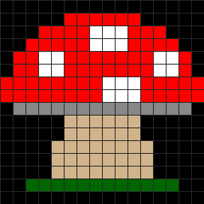 |
| **21** | **Scarecrow** | Blinking Eyes & Waving Straw | 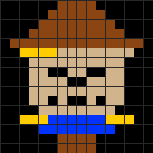 |
| **22** | **Poison Apple** | Dripping Green Skull Poison | 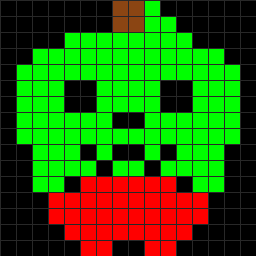 |
| **23** | **Flickering Candle** | Dancing Flame & Melting Wax | 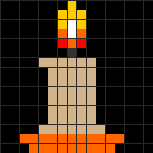 |
| **24** | **Falling Acorn** | Swaying Oak Nut & Leaf | 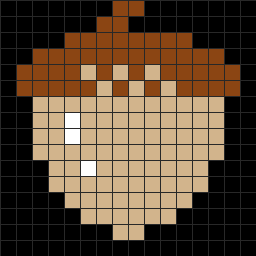 |
| **25** | **Spellbook** | Floating Pentagram & Magic Sparks | 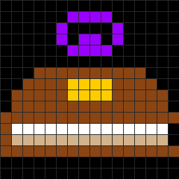 |
| **26** | **Campfire** | Crackling Flames & Rising Embers | 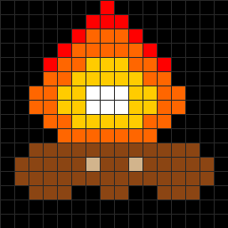 |
| **27** | **Frankenstein's Bride** | Electric Hair Streaks | 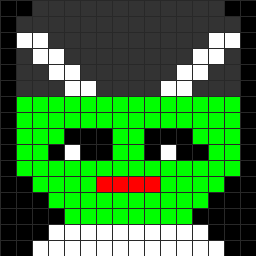 |
| **28** | **Werewolf** | Howling at the Moon | 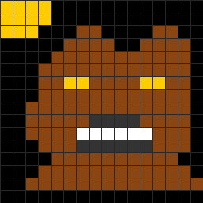 |
| **29** | **Spiderweb** | Dew Glint & Caught Fly | 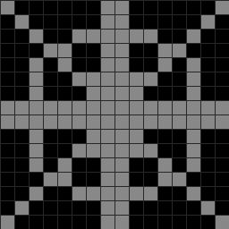 |
| **30** | **Magic Potion** | Swirling Color-Changing Elixir | 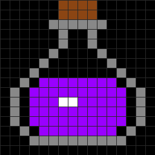 |
| **31** | **Grim Reaper** | Glowing Eyes & Gleaming Scythe | 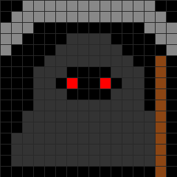 |
| **32** | **Harvest Cornucopia** | Bountiful Autumn Shimmer | 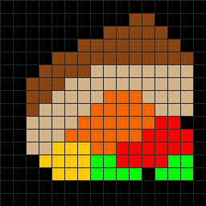 |

Viel Spass beim Ausprobieren und Programmieren eigener Animationsmuster!
